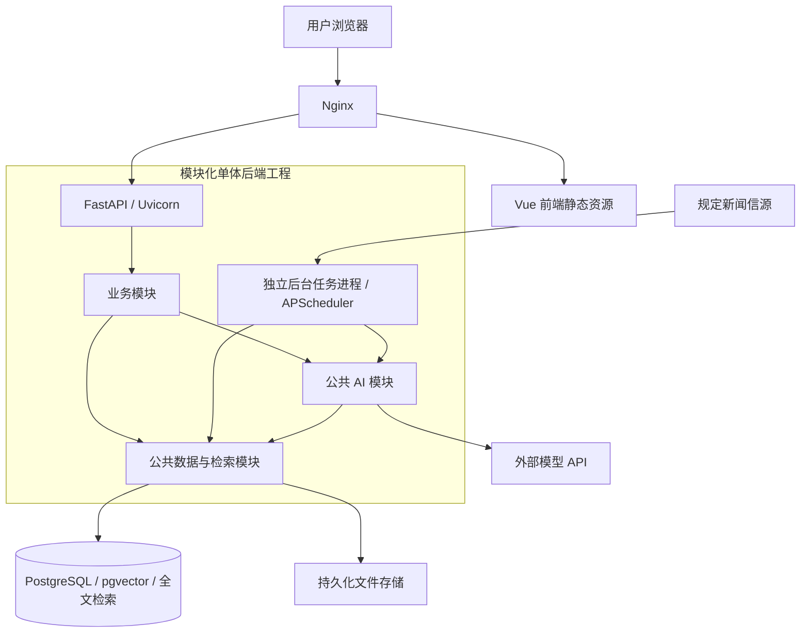

# G20 新闻生产智能体技术栈设计

版本：V1.0

## 1. 设计范围

本文件定义项目现阶段的技术架构、技术栈及公共工程约束，作为项目工程初始化、详细设计和模块开发的技术依据。

首版开发范围包括规定信源采集、数据预处理、统一资料库、热点推送、智能问答、通稿研读、选题工作台，以及选题单生成、编辑、复制和导出。订阅、工具包、分区共享及多人协作属于后续开发范围。

具体数据库表结构、API 接口、项目目录及业务处理规则由对应的设计文档定义。

## 2. 整体技术架构

| 设计事项 | 技术方案 |
| --- | --- |
| 前后端组织 | 前后端分离 |
| 后端架构 | 模块化单体（Modular Monolith） |
| 仓库组织 | GitHub 单仓库（Monorepo） |
| 数据存储 | 统一数据存储架构 |
| 后台任务 | 独立后台任务进程，复用后端公共模块 |
| AI 能力 | 后端内部统一公共 AI 模块 |
| 部署方式 | 容器化部署 |

前端通过统一 API 与后端通信。各业务模块在同一后端工程内按职责组织，共用资料管理、检索、证据引用和 AI 模型调用能力。Web 服务与后台任务分别运行，使用统一的数据存储及配置体系。

## 3. 前端技术栈

| 技术类别 | 技术方案 |
| --- | --- |
| 开发语言 | TypeScript、HTML、CSS |
| 核心框架 | Vue 3、Composition API、`script setup` |
| 运行环境 | Node.js 24 LTS |
| 构建工具 | Vite |
| 应用模式 | SPA（单页应用） |
| UI 组件 | Element Plus、自定义业务组件 |
| 样式管理 | SCSS、CSS Variables、Scoped CSS |
| 页面路由 | Vue Router |
| 状态管理 | Pinia |
| 接口类型生成 | openapi-typescript |
| HTTP 请求 | openapi-fetch |
| 流式响应 | SSE + Fetch 流式读取 |
| Markdown 渲染 | markdown-it |
| HTML 安全处理 | DOMPurify |
| 富文本编辑 | Tiptap，完成证据引用编辑与导出验证后接入 |
| 数据可视化 | Apache ECharts（按需引入） |
| 包管理 | pnpm |
| 代码质量 | ESLint、Prettier、vue-tsc、EditorConfig |
| 自动化测试 | Vitest、Vue Test Utils、Playwright |

## 4. 后端技术栈

| 技术类别 | 技术方案 |
| --- | --- |
| 开发语言 | Python 3.14；核心依赖不兼容时统一回退至 3.13 或 3.12 |
| Web 框架 | FastAPI |
| ASGI 服务器 | Uvicorn |
| 数据校验 | Pydantic 2.x |
| 配置管理 | Pydantic Settings、环境变量 |
| 依赖与环境管理 | uv |
| API 通信 | REST API + JSON；流式场景使用 SSE |
| 接口描述与调试 | OpenAPI、Swagger UI |
| 代码质量 | Ruff |
| 自动化测试 | pytest、FastAPI TestClient |

Python 运行版本通过核心依赖兼容性测试后锁定；项目依赖统一由 `pyproject.toml` 和 `uv.lock` 管理，运行版本记录于 `.python-version`。

## 5. 数据存储与检索技术栈

| 技术类别 | 技术方案 |
| --- | --- |
| 主数据库 | PostgreSQL 18.x；扩展或驱动不兼容时采用 17.x |
| ORM | SQLAlchemy 2.x |
| 数据库驱动 | Psycopg 3 |
| 数据库迁移 | Alembic |
| 数据库访问 | Web 端以异步访问为主，统一 Session、连接池及事务管理 |
| 向量存储与检索 | pgvector、pgvector-python；HNSW 索引按需建立 |
| 多语言全文检索 | PGroonga；扩展无法部署或验证不通过时采用 PostgreSQL 原生全文检索与应用层分词 |
| 综合检索 | 条件筛选、关键词检索、向量检索；RRF 排序融合经效果验证后启用 |
| 文件存储 | 本地持久化文件存储，预留对象存储接口 |
| 缓存 | 轻量缓存按需使用，首版不依赖 Redis |
| 数据标识 | UUID（以 UUIDv7 为基线）、SHA-256、外键关联 |
| 证据追溯 | 原文版本管理、稳定的证据标识及原文位置关联 |
| 备份与恢复 | pg_dump、pg_restore、持久化文件备份 |

PostgreSQL 作为统一主数据库，管理新闻资料、信源、处理结果、会话、证据和工作台等业务数据。文件存储保存需留存的原始文件及业务文件，数据库维护文件元数据和关联关系。数据库与检索扩展的实际版本须通过联合运行测试后锁定。

## 6. 新闻采集与数据处理技术栈

| 技术类别 | 技术方案 |
| --- | --- |
| 信源管理 | 信源注册表、Adapter 架构、PostgreSQL、YAML |
| 采集方式 | 公开 API、RSS/Atom、静态网页；动态网页作为补充 |
| 网络请求 | HTTPX |
| RSS 解析 | Feedparser |
| HTML/XML 解析 | Beautiful Soup 4、lxml |
| 正文提取 | 信源专用规则、Trafilatura |
| 动态网页采集 | Playwright Python、Chromium（按需启用） |
| PDF 解析 | pdfplumber |
| OCR | Tesseract（按需验证），PaddleOCR 作为备选 |
| 数据清洗与校验 | Python 标准库、dateparser、Pydantic |
| 语言识别 | 信源语言信息；Lingua 按需验证后启用 |
| 去重及更新 | URL 规范化、SHA-256、数据库唯一约束、原文版本管理；近似去重按需引入 |
| 采集模式 | 历史补采、增量采集、手动采集 |
| 任务记录 | PostgreSQL 任务状态及采集检查点 |
| 定时调度 | APScheduler 3.x、独立后台任务进程 |
| 并发及重试 | asyncio、HTTPX 连接池、Tenacity |
| 日志 | Python logging、structlog |
| 测试 | pytest、HTTPX MockTransport、固定样本、PostgreSQL 集成测试 |

采集模块统一负责资料获取、正文和元数据提取、清洗、去重及入库，保留原始语言、来源信息及原文版本，不承担新闻价值评级等下游业务分析。

## 7. AI 能力技术栈

| 技术类别 | 技术方案 |
| --- | --- |
| AI 开发方式 | Python 自主代码开发、显式业务工作流 |
| 能力组织 | 后端公共 AI 模块，统一模型适配器 |
| 模型部署方式 | 云端模型 API |
| 模型服务 | 阿里云百炼、Qwen 系列 |
| 模型调用 | OpenAI Python SDK、HTTPX、供应商适配器 |
| Embedding | 多语言文本向量模型，通过 pgvector 存储和检索向量 |
| Reranker | 多语言重排序模型（按需启用） |
| 知识增强 | 自主实现混合检索 RAG |
| 文档切分 | 基于文档结构的递归切分、Token 长度控制、原文位置保留 |
| 结构化输出 | JSON Schema、Pydantic 2.x；使用模型支持的原生结构化输出能力 |
| Prompt 管理 | Jinja2、YAML、Git |
| 会话管理 | PostgreSQL 会话持久化、应用层上下文管理 |
| 证据校验 | Evidence ID 约束、数据库确定性校验、模型辅助事实支持度检查 |
| 任务及异常处理 | 复用后台任务进程、PostgreSQL、HTTPX、Tenacity、asyncio |
| AI 效果评估 | pytest、固定新闻评测集、自定义评估脚本；Ragas 按需引入 |

热点推送、智能问答、通稿研读及选题工作台分别实现业务工作流，通过公共 AI 模块调用模型服务。具体生成模型、Embedding 模型、Reranker 模型及其参数由实际 API 可用性、新闻样本评测和运行成本确定，统一纳入配置管理，不在业务代码中写死。

## 8. 工程化与部署技术栈

| 技术类别 | 技术方案 |
| --- | --- |
| 版本管理 | Git |
| 代码托管与协作 | GitHub、任务分支、Pull Request |
| 容器化 | Docker |
| 服务编排 | Docker Compose |
| Web 访问入口 | Nginx（静态资源服务、反向代理） |
| 持续集成 | GitHub Actions（代码检查、测试及构建） |
| 依赖锁定 | uv.lock、pnpm-lock.yaml |
| 环境配置 | 环境变量、`.env.example` |
| 持久化 | 数据卷或授权的挂载目录 |
| 运行监控 | 结构化日志、健康检查、数据库任务记录 |

基础部署单元包括 Nginx、Web 后端、独立后台任务进程及 PostgreSQL。前端构建产物由 Nginx 提供访问；数据库和业务文件使用持久化存储。外部 AI API 由后端及后台任务按统一配置访问。

## 9. 首版依赖边界

首版不将以下技术作为基础依赖：

- LangChain、LlamaIndex、LangGraph、Dify、Coze 等 AI 开发或编排框架及平台；
- Redis、Celery、RabbitMQ 等独立缓存及分布式任务组件；
- Elasticsearch、OpenSearch 及独立向量数据库；
- Kubernetes、Prometheus、Grafana；
- 本地大语言模型部署环境。

标注按需启用的工具不要求在基础工程中一次性安装。局部功能需要新增依赖时，遵循仓库协作规范，避免形成重复或不兼容的技术体系。

## 10. 公共开发约束

- 前端通过后端 API 操作业务数据；OpenAPI 契约与前端生成类型保持一致。
- 各业务模块共用统一资料库及引用机制，原文更新不得破坏已有引用关系。
- AI 模型调用通过公共适配器完成，模型配置及密钥统一管理。
- 前后端依赖分别通过 uv、pnpm 管理，锁定文件随代码提交；运行时及容器镜像使用统一版本，不以 `latest` 作为正式运行配置。
- 数据库结构变更通过 Alembic 迁移管理，并遵守仓库跨模块变更及 PR 审核规范。
- 密钥、访问令牌、真实用户数据和含敏感配置的本地环境文件不得提交仓库。
- 新闻采集遵守信源准入、访问限制和内容使用权限；外部资料作为不可信数据处理。
- Codex 等辅助开发工具须遵守项目技术架构和协作规范，不擅自替换核心框架、数据库、公共接口或部署方式。

## 11. 运行环境与配置条件

当前技术设计不代表实际部署或兼容性测试已经完成。以下条件在工程初始化和运行验证过程中落实：

| 类别 | 环境与配置条件 |
| --- | --- |
| 服务器 | 操作系统、CPU、内存、磁盘、SSH、软件安装及 Docker 权限 |
| 网络 | 新闻信源及模型 API 的可达性、端口、域名与 HTTPS |
| 运行时 | Python、Node.js、PostgreSQL 及相关依赖的兼容版本 |
| 数据库扩展 | pgvector 与 PGroonga 的联合安装及检索效果 |
| 模型服务 | API 权限、可用模型、额度、预算及向量索引配置 |
| 文件存储 | 持久化目录、读写权限、容量、对象存储可用性及备份条件 |
| 可选组件 | Tiptap、动态网页采集、OCR、语言识别及重排序能力的实际适用性 |

具体软件包版本由依赖锁定文件记录；具体部署配置由目标环境及容器编排文件定义。业务规则、数据模型、接口字段及算法参数由后续详细设计文档定义。
